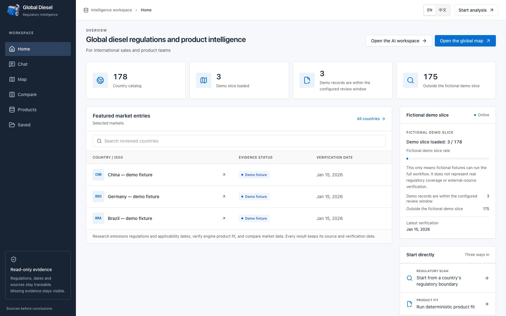
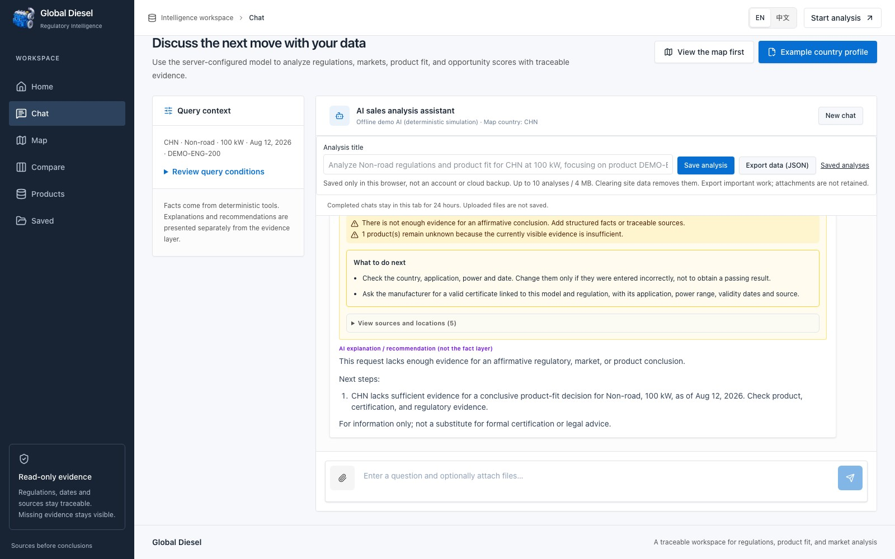
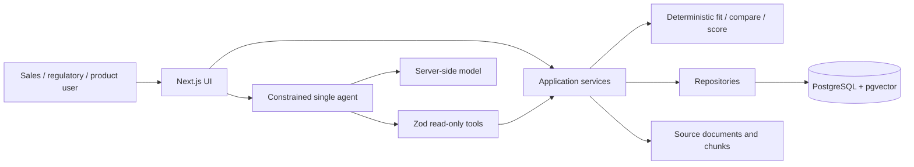

# Global Diesel Regulatory Intelligence

> A source-grounded regulation, product-fit, and market-analysis workspace built
> as a Forward Deployed Engineer portfolio project.

[](https://github.com/Jameskyzx/diesel/actions/workflows/ci.yml)

[Live demo](https://diesel.jamesky.site) ·
[World map](https://diesel.jamesky.site/map) ·
[AI workspace](https://diesel.jamesky.site/chat) ·
[FDE case study](docs/FDE_CASE_STUDY.md) ·
[Current status](docs/STATUS.md) ·
[中文 README](README.zh-CN.md)

The linked subdomain is the new deployment target. Until migration and readback
are confirmed in [STATUS.md](docs/STATUS.md), use the local demo for this release.

This project models the work behind an international diesel-engine sales
decision: which rules apply to a country, date, application, and power band;
whether product evidence supports a fit; whether market observations are
comparable; and exactly which sources support each conclusion.

Structured data and deterministic application code own regulatory facts,
product fit, availability, and scores. The LLM can select validated read-only
tools and explain their output, but it cannot invent a regulation,
certification, product specification, or opportunity score.

The screenshot below is the English zero-configuration demo, not a claim that
the current public release already contains these local changes:



## Three-minute overview

### The user problem

A sales engineer usually has to reconcile regulatory status, applicability
dates, power bands, application scope, product certification, commercial
availability, market methodology, and source freshness. A mistake in any one
of those dimensions can turn a plausible recommendation into an unsupported
sales commitment.

### The golden workflow

1. Select a country on the [world map](https://diesel.jamesky.site/map); the ISO3 URL
   is shareable.
2. Review current `effective` rules, future `adopted` rules, source links, and
   verification dates.
3. Enter application, power, date, and optionally a model code. `product-fit-v2`
   returns compliance fit, query-date availability, and combined commercial
   readiness as separate deterministic fields.
4. Ask the [AI workspace](https://diesel.jamesky.site/chat) for a comparison or sales
   brief. Structured tool cards and citations remain distinct from model prose.
5. Missing data, stale evidence, proposed rules, and absent certifications stay
   explicit. The system does not make optimistic geographic or power-band
   extrapolations.

The offline demo uses clearly fictional fixtures and never calls an external
model:



### Current evidence boundary

- Reviewed publication closure: **97 jurisdictions, 28 regulations, 651 limits,
  and 203 sources**.
- Approved real-product and certification fixtures: **0**.
- Country directory: **178 ISO3 entries**. A directory entry or published
  evidence boundary does not mean that every application scope has a numeric
  emissions limit.
- Demo products: **2 fictional configurations**, used only to exercise
  `fit / not_fit / unknown` and availability behavior.
- Product catalogue: **24 fictional `DEMO-` models** whose declared regulation
  citations are matched against a target market on `/products`; declarations are
  not certification.

Live database state, code state, and historical measurements are deliberately
kept separate in [STATUS.md](docs/STATUS.md).

In the current local build, public routes default to English and can switch to
Simplified Chinese without changing the current path or query. The preference
persists for one year; page metadata, country names, dates, ARIA copy,
application scopes, jurisdiction types, and certification statuses follow the
selected locale. Official source titles and original excerpts remain in their
source language. Deployment status is tracked separately in
[STATUS.md](docs/STATUS.md).

## Three engineering decisions

### 1. Evidence-gated AI

Every fact tool has Zod-validated input and structured output. Chat runs one
bounded loop (at most five model calls, no retries) in which the model only emits
typed actions: edit the working conditions, query evidence, search the catalogue,
or finish. The server validates each action against the user's own words, compiles
it into an exact tool call, and copies operands such as dates, metric codes,
source terms and page/section locators from the user's text rather than from the
model. Facts in the answer are rendered by the server from validated tool results;
the model's closing message may only carry general guidance or a question. Missing,
malformed or insufficient evidence is shown as an explicit evidence gap.

Typed provider reasoning parts are discarded and never forwarded to the
browser; recognized reasoning markup in ordinary model text also fails closed.
`AI_ENABLE_THINKING` only requests provider-side inference. Deployments must use
a provider contract that keeps private reasoning out of untagged response text,
because unlabelled prose cannot be identified semantically as chain-of-thought.

### 2. Regulatory time is explicit

Record status, business validity, adoption date, and source verification time
are modeled separately. Queries use ISO3, application scope, power, `asOf`, and
half-open `[from,to)` intervals. `statusAtAsOf` is derived for the query date
while `recordStatus` preserves the current record state. A now-superseded rule
can still be returned for a closed historical period; a proposed rule is never
treated as effective.

This is not a complete bitemporal `knownAsOf` database, and the documentation
does not claim otherwise.

### 3. Recommendations are reproducible

Product fit, market comparability, commercial readiness, and opportunity scores
are calculated by versioned deterministic code. Missing dimensions remain
`null` or `unknown`, coverage is visible, and the model can explain but cannot
alter a score.

## Run locally with one command

Requirements: Node.js 22+ and pnpm 11.

```bash
pnpm install
pnpm demo
```

Open <http://127.0.0.1:3000>. No `.env.local`, PostgreSQL, Docker, or AI key is
required.

The demo is intentionally development-only:

- it creates an in-process PGlite database from the tracked Drizzle migrations;
- it inserts stable IDs and visibly fictional `DEMO ONLY` / `.invalid` sources;
- a deterministic offline model selects the same read-only tools;
- requests still cross the production repository, service, Zod, audit, and
  evidence-boundary layers;
- developer database credentials, model keys, and private documents are not
  read or transmitted.

Suggested questions:

```text
Which regulations are effective in CHN today?
Is DEMO-ENG-100 ready for CHN non-road use at 100 kW?
Compare CHN and BRA non-road regulations at 100 kW.
```

The failure-first interview walkthrough is in [DEMO.md](docs/DEMO.md).
For an independent, bilingual API/UI exercise with expected results and a
handoff checklist, follow the [local evidence lab](docs/LOCAL_EVIDENCE_LAB.md).

For a local, mutable implementation workflow, use:

```bash
pnpm demo:fde
```

It binds only to loopback, uses a fresh fictional PGlite database, and keeps a
`LOCAL / MUTABLE / FICTIONAL` boundary visible while demonstrating CSV preview,
draft, review/publish, query readback, and archive. It never touches the public
database.

## Architecture



- Server Components handle read-first pages; Client Components are limited to
  browser interaction such as MapLibre and chat.
- Route handlers validate external input before invoking application services.
- Database access stays behind repositories and services.
- The AI has no arbitrary SQL, fact-writing, open-web, or sub-agent capability.

See [ARCHITECTURE.md](docs/ARCHITECTURE.md) and
[DATA_MODEL.md](docs/DATA_MODEL.md) for the detailed boundaries.

## Data provenance

Public responses distinguish two categories record by record:

- **Fictional demo data**: `is_demo=true`, `DEMO ONLY`, and `.invalid` sources.
- **Reviewed public-source fixtures**: published through the Draft → Reviewed →
  Published governance path. They still require review of the original source,
  scope, and validity period and are not legal or certification advice.

There is currently no approved real product master-data or certification
fixture. Real regulation evidence must therefore never be combined with a demo
product and described as a real commercial-availability conclusion.

## Verification

Pick checks by impact, as described in [AGENTS.md](AGENTS.md#scope-and-validation):

```bash
pnpm lint
pnpm typecheck
pnpm test          # Vitest, including the offline AI harness eval
pnpm build
pnpm test:e2e      # Playwright public flows (PGlite demo database)
```

`pnpm test:e2e:demo`, `pnpm test:e2e:fde` and `pnpm test:e2e:csp:production` cover the
zero-config demo, the failure-first FDE workflow and the production CSP contract.
PostgreSQL smoke checks (`pnpm db:smoke:*`) need a real PostgreSQL + pgvector database.

CI runs all of the above plus secret scanning, the dependency advisory policy, the
deployment-script contracts and a Linux release-handoff smoke test; a single
`Required CI gate` job aggregates them for branch protection. The paid live AI eval
(`pnpm ai:eval:live`) and the production canary are described in
[docs/evals](docs/evals/README.md) and [STATUS.md](docs/STATUS.md).

## Standard development environment

```bash
pnpm install
cp .env.example .env.local
pnpm db:migrate
pnpm db:seed
pnpm dev
```

Important server-only configuration includes `DATABASE_URL`, `DATABASE_MODE`,
`AI_API_KEY`, `AI_BASE_URL`, `AI_MODEL`, `AI_MULTIMODAL_MODEL`,
`AI_INCLUDE_USAGE`, optional `AI_COST_PROFILE_JSON`,
`AI_CHAT_RATE_LIMIT_BACKEND`, `AI_CHAT_RATE_LIMIT_GLOBAL_PER_HOUR`,
`AI_CHAT_RATE_LIMIT_PER_HOUR`,
`AI_CHAT_ADMISSION_GLOBAL_PROVIDER_CALL_UNITS_PER_DAY`,
`AI_CHAT_ADMISSION_CLIENT_PROVIDER_CALL_UNITS_PER_DAY`, `KNOWLEDGE_STORAGE_ROOT`, and
`ADMIN_ROLE_BINDINGS_JSON`. Complete production, proxy, backup, rollback, and
canary boundaries are documented in [DEPLOYMENT.md](docs/DEPLOYMENT.md).

Hourly Chat admission uses an epoch-aligned fixed one-hour window. The optional
global limit defaults to the compatibility ceiling of 10,000 requests/hour;
both hourly values must be integers from 1 through 10,000, and the per-client
limit must not exceed the global limit. The production example intentionally
sets global/client to 300/30 and uses the PostgreSQL backend. PostgreSQL shares
the counters across application instances and reserves global, then client, in
one transaction: a full global bucket never touches the client bucket, while a
full client bucket rolls back the provisional global increment. A rejection
does not commit a `limit + 1` row, and an admitted request is not refunded after
later parsing, configuration, audit, or provider failure. Only a SHA-256 digest
of the resolved client identity is stored. Cleanup is retention-only, runs
outside the request decision, and removes at most 500 expired rows per process
per minute. The required PostgreSQL CI job now includes a loopback-only smoke
that asserts five distinct backend sessions and reads back both global- and
client-exhaustion rollback scenarios. This working tree has not yet received
that remote CI receipt, and none of these changes prove that the current public
deployment has been upgraded.

## Review paths

- Why a modular monolith instead of microservices? See
  [ARCHITECTURE.md](docs/ARCHITECTURE.md).
- How does the evidence gate fail closed? See the sales-chat service and its
  adversarial tests.
- How are source validity and product availability queried? See
  [DATA_MODEL.md](docs/DATA_MODEL.md).
- Which data is real, reviewed, demo-only, or still absent? See
  [STATUS.md](docs/STATUS.md), [ACCEPTANCE.md](docs/ACCEPTANCE.md), and
  [PRODUCT_EVIDENCE.md](docs/PRODUCT_EVIDENCE.md).
- What incremental development history survived the consolidated public
  snapshot? See [DEVELOPMENT_HISTORY.md](docs/DEVELOPMENT_HISTORY.md).

## AI-assisted development disclosure

Coding agents assisted with implementation, mechanical organization, and
adversarial review. The author owns problem framing, data boundaries, schema and
ADR decisions, acceptance criteria, publication red lines, and final review.
Agent output cannot bypass source readback, automated tests, migrations, or
human approval.

## Disclaimer

This is a public portfolio project, not an official system of any engine
manufacturer, regulator, or employer. Verify original sources, applicability,
effective dates, and formal certifications before use. Nothing here constitutes
legal, certification, sales, investment, or regulatory advice.
