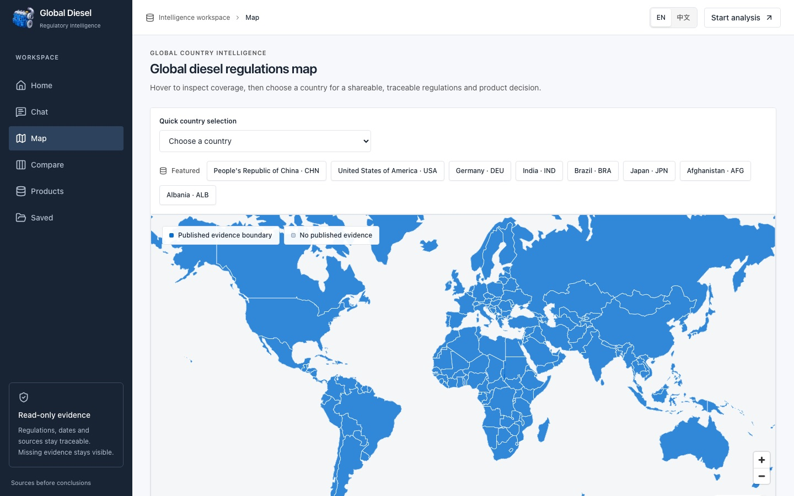
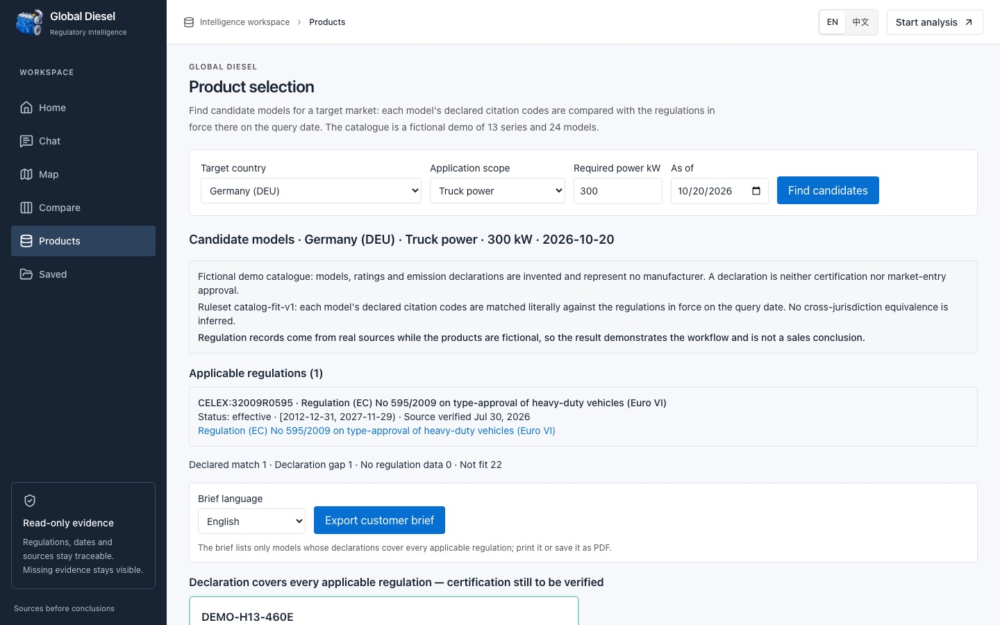
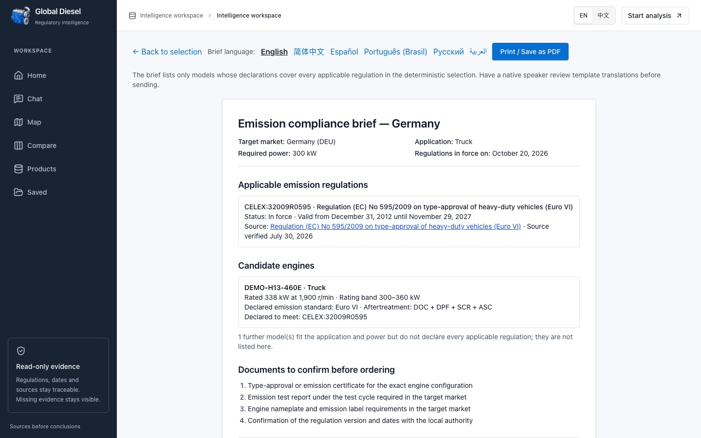

# Global Diesel — emission rules and product fit for overseas sales

**[Open the live site →](https://diesel.jamesky.site)** · [中文介绍](README.zh-CN.md)

Before quoting a diesel engine to an overseas customer, a sales team has to answer
three questions: *Which emission rules apply in that country? Which of our engines
meet them? How do we show this to the customer clearly?* Today that means digging
through foreign regulations, spec sheets and spreadsheets by hand.

I work in overseas marketing at a diesel-engine manufacturer, and built this tool
to turn that process into a few clicks.

## What you can do

**1. See the rules on a world map.** Pick a country to see the emission regulations
in force, the ones coming next, and a link to each official source.



**2. Find engines for a target market.** Choose a country, an application (truck,
bus, construction, agriculture, generator set, marine) and the required power. The
tool lists the engines whose declared emission standards cover every rule in force,
and flags the ones that fall short.



**3. Export a customer brief in one click.** A one-page summary of the rules and
recommended engines, in English, Chinese, Spanish, Portuguese, Russian or Arabic,
ready to print or save as PDF.



**4. Ask the AI assistant.** Ask questions in plain English or Chinese, such as
*"Compare China and Brazil non-road rules at 100 kW"*. Answers come with their
sources.

## Why the answers can be trusted

- **Facts come from verified data, not from the AI.** Regulations are entered from
  official sources and reviewed before publishing; the AI can only look them up and
  explain them.
- **Every answer shows its source** and the date the source was checked.
- **Gaps are stated, not guessed.** If data is missing for a country or power range,
  the tool says so instead of inventing an answer.

## At a glance

| | |
| --- | --- |
| Countries checked against official sources | 97 (28 regulations, 203 sources) |
| Countries in the directory | 178 |
| Engine catalogue | 24 models — **fictional demo data**, not any real manufacturer |
| Languages | Site in English and Chinese; customer brief in 6 languages |

## For technical readers

Built with Next.js, TypeScript, PostgreSQL and an OpenAI-compatible model, with
automated tests and CI on every change. To run it locally with demo data (no
database or API key needed):

```bash
pnpm install
pnpm demo
```

More detail: [architecture](docs/ARCHITECTURE.md) · [data model](docs/DATA_MODEL.md) ·
[demo walkthrough](docs/DEMO.md) · [case study](docs/FDE_CASE_STUDY.md) ·
[current status](docs/STATUS.md) · [deployment](docs/DEPLOYMENT.md)

Coding agents helped with implementation and review; I own the problem framing,
data rules, design decisions and final review.

---

A personal portfolio project, not an official system of any manufacturer or
regulator. Always check the original regulation and the engine's certification
before making a commitment.
