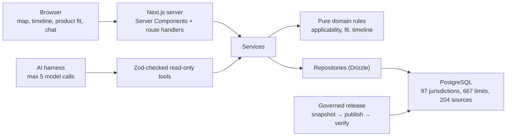

# Global Diesel in five minutes / 五分钟看懂

[中文](#中文) · Live demo: <https://diesel.jamesky.site> · Current numbers: [STATUS.md](STATUS.md)

## English

### What it is

A tool for overseas diesel-engine sales: pick a country, application and power,
and see which emission rules apply on a given date, which engines declare them,
and when the rules change. Every fact shows its source and verification date.
It is a public, read-only portfolio demo, not legal advice; the engine catalogue
is fictional (`DEMO-` models).

### How it fits together

The browser never holds keys or SQL. Facts come only from PostgreSQL; rules are
deterministic code; the model only picks tools and explains checked results.

### Three trade-offs

1. **Facts are data, not model output.** Regulations, limits and catalogue
   declarations are reviewed fixtures with sources. The model cannot write or
   upgrade them, and when evidence is missing the server returns a fixed
   evidence-gap reply instead of the model's text. Cost: coverage grows only
   as fast as reviewed data does.
2. **Status is explicit.** Proposed is never shown as effective; a declaration
   is never shown as certification; missing data is "no data", not "not
   regulated". The new [timeline](PUBLIC_UI.md) labels a proposed date as
   "not adopted, not binding".
3. **Releases fail closed.** Every governance release takes a consistent
   database snapshot before writing, rehearses a restore, and rolls the host
   back on any failure. Cost: releases are slow and strict (see below).

### One incident

On 2026-11-23 and 2026-11-25 the November re-verification release failed. The
server-to-database link was 3–6× slower than usual, and the pre-write snapshot
ran out of its 90-minute budget while reading `data_change_logs`. Both attempts
rolled back safely: no data was written and production stayed on the previous
release.

Diagnosis: on the slow link the export is bandwidth-bound, and most of its bytes
are JSON audit rows that grow with every release. Fix (in code, not yet
released): the exporter reads a SHA-256 digest per row inside PostgreSQL, reuses
rows from the previous snapshot whose digest matches, and fetches only new or
changed rows. The snapshot file is byte-identical, so restore and comparison
contracts do not change. Details: [DEPLOYMENT.md](DEPLOYMENT.md), search
"快照行复用".

### Where to read next

[FDE case study](FDE_CASE_STUDY.md) · [architecture](ARCHITECTURE.md) ·
[data model](DATA_MODEL.md) · [public UI contracts](PUBLIC_UI.md) ·
[decision log](DECISIONS.md)

## 中文

### 这是什么

给海外柴油机销售用的工具：选国家、应用和功率，就能看到某个日期适用哪些排放法规、哪些机型
声明满足、法规什么时候变化。每条事实都显示来源和核验日期。这是公开只读的作品演示，不是法律
意见；产品目录是虚构的 `DEMO-` 机型。

### 结构

见上方架构图。浏览器不持有密钥或 SQL；事实只来自 PostgreSQL，规则是确定性代码，模型只负责
选工具和解释已校验的结果。

### 三个取舍

1. **事实是数据，不是模型输出。** 法规、限值和目录声明都是带来源的审核数据，模型不能写入或
   拔高；证据不足时服务端返回固定的“证据缺口”回复，丢弃模型文本。代价是覆盖范围只能随审核
   数据一起增长。
2. **状态必须显式。** 拟议不显示为生效，声明不显示为认证，缺数据显示为“无数据”而不是“不受
   监管”。新的[时间线](PUBLIC_UI.md)会把拟议日期标为“未采纳，不具约束力”。
3. **发布失败即关闭。** 每次治理发布在写入前导出一致的数据库快照、演练恢复，任何失败都回滚
   主机。代价是发布慢且严格（见下）。

### 一次故障

2026-11-23 和 11-25，十一月复核发布两次失败：服务器到数据库的链路比平时慢 3–6 倍，写入前
快照在读取 `data_change_logs` 时耗尽 90 分钟预算。两次都安全回滚，没有写入数据，线上保持上一
版本。

诊断：慢链路下导出受带宽限制，主要字节是每次发布都在增长的 JSON 审计行。修复（已在代码中，
尚未发布）：导出器先在 PostgreSQL 内读取每行的 SHA-256 摘要，摘要与上一份快照一致的行直接
复用，只读取新增或变化的行。快照文件逐字节相同，恢复和比较契约不变。详见
[DEPLOYMENT.md](DEPLOYMENT.md) 中的“快照行复用”。

### 接着读

[FDE 案例](FDE_CASE_STUDY.md) · [架构](ARCHITECTURE.md) · [数据模型](DATA_MODEL.md) ·
[公开界面契约](PUBLIC_UI.md) · [决策记录](DECISIONS.md)
